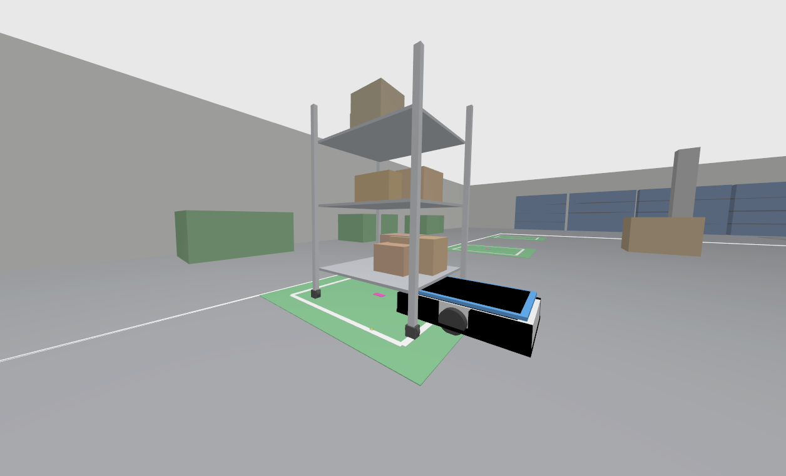

# ARNav : Autonomous Rack Navigation Simulation

A ROS 2 + Ignition Gazebo simulation of a warehouse robot that finds a rack with LiDAR, drives under it, lifts it with a jack, carries it to another slot or work station, and sets it down. Navigation uses SLAM-built maps, AMCL localization and Nav2. Pick and place are checked against simulated RFID tags.



## Build

```bash
cd ~/ARNav_ws            # put src/ here
rosdep install --from-paths src --ignore-src -y
colcon build --symlink-install
source install/setup.bash
```

Needs: ROS 2 Humble, Ignition Gazebo Fortress, `ros_gz`, `nav2_bringup`, `slam_toolbox`, `xacro`.

## Run

Three terminals (source the workspace in each):

```bash
ros2 launch arnav_bringup bringup.launch.py        # Gazebo + robot + rack stack

ros2 launch arnav_navigation navigation.launch.py  # map server, AMCL, Nav2

ros2 run arnav_mission move_rack slot_01 w1        # move a rack
```

Launch options: `gui:=false` (headless), `camera:=false`, `render_engine:=ogre` (if ogre2 fails).

RViz: `rviz2 -d $(ros2 pkg prefix --share arnav_bringup)/rviz/arnav.rviz`

## Layout

41 m × 25 m warehouse. 10 centre slots 
(`slot_01`–`slot_10`, each holding a rack), 
6 empty work stations (`w1`–`w3` left, `w4`–`w6` right), home at (0, -9).


## Packages

`arnav_description` (robot model) · `arnav_sim` (world, layout, launch) · `arnav_interfaces` (msgs/actions) · `arnav_rack` (detection, docking, jack, RFID) · `arnav_mapping` (SLAM + map) · `arnav_localization` (AMCL) · `arnav_navigation` (Nav2) · `arnav_mission` (CLI) · `arnav_bringup` (top-level launch, RViz)

## Config

Edit `arnav_sim/config/layout.yaml` (slots, home, RFID), `arnav_rack/config/rack.yaml` (rack size, docking speeds), and `arnav_navigation/config/navigation_params.yaml` (Nav2).

## Troubleshooting

- Gazebo black screen or crash: use `render_engine:=ogre` or `gui:=false`.
- "already running" error: kill old Gazebo/Nav2 processes first.
- `/arnav/pick_rack not available`: start `arnav_bringup` first.

## License

MIT. See `LICENSE`.
